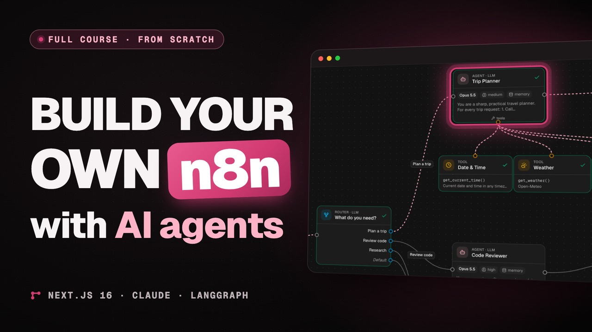
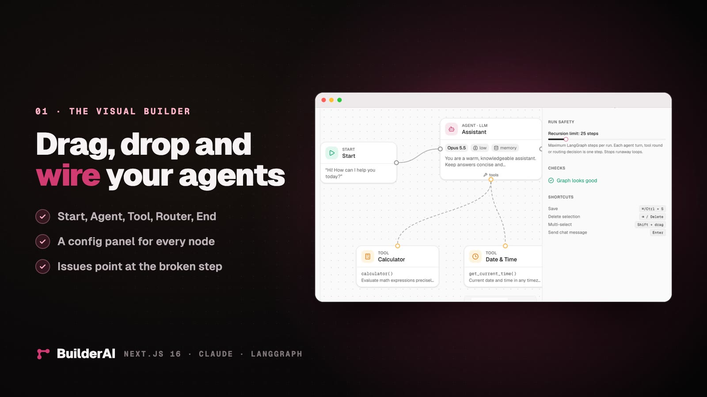
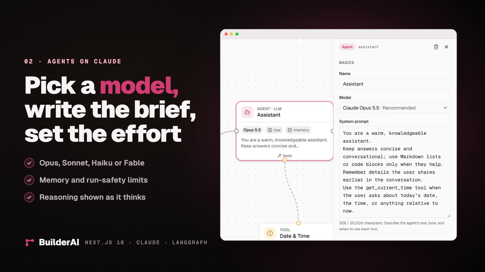
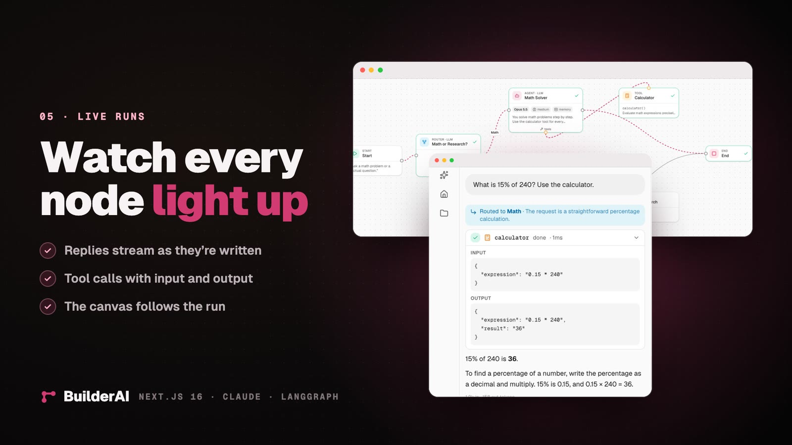
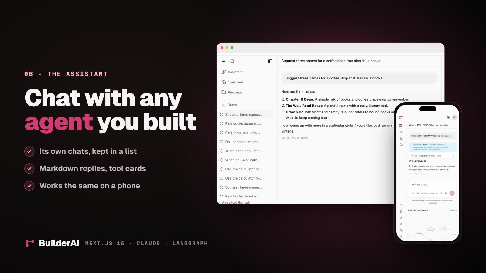
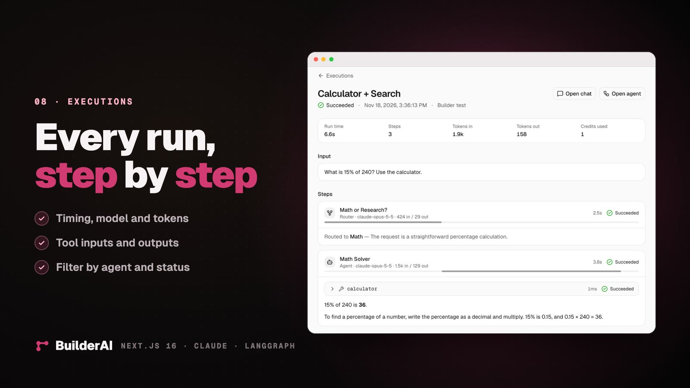
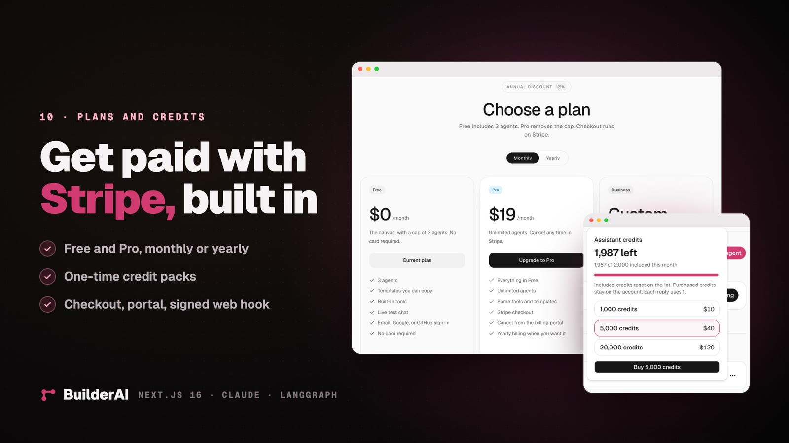

<div align="center">

<a href="https://youtu.be/eLkdlGRQLgQ"></a>

# BuilderAI starter

### Build your own n8n, where every node thinks.

The companion repo for **BuilderAI from Scratch**, a free 9 h 42 min course on YouTube. You build a visual AI agent
builder with Next.js 16, Claude, LangGraph, Prisma 7, Better Auth and Stripe, from an empty folder to live on Vercel,
typing every file and understanding every line.

**[▶ Watch the course](https://youtu.be/eLkdlGRQLgQ)** ·
**[📝 Read the article](https://medium.com/@reactbd/next-js-developers-can-build-an-n8n-style-agent-builder-the-compiler-is-125-lines-4d0a51f21c00)** ·
**[⚡ Get the full source code](https://buymeacoffee.com/reactbd/extras)** ·
**[🌐 reactbd.com](https://reactbd.com)**

</div>

---

## What you'll build

BuilderAI is an AI agent builder like n8n: people design agents on a canvas, give them tools, wire routers between
them, and chat with them while every node lights up as it runs. Each run compiles the canvas into a LangGraph graph and
executes it on the server with Claude.

| | |
| --- | --- |
|  |  |
| **The visual builder.** Start, Agent, Tool, Router and End nodes on a React Flow canvas, a config panel for every node, and an issues list that points at the broken step. | **Agents on Claude.** Pick the model per agent, write its instructions, set the effort, memory and run-safety limits, and give it tools. |
|  |  |
| **Live runs.** Replies stream as they're written, tool calls show their input and output, and the canvas follows the run node by node. | **The Assistant.** Chat with any of your agents from one place, with its own conversation list, on desktop and phone. |
|  |  |
| **Executions and Insights.** Every run saved step by step, with timing, model, tokens and tool calls, and charts over 7, 30 or 90 days. | **Plans and credits.** Free and Pro with Stripe Checkout, the billing portal, one-time credit packs and a signed web hook. |

Plus: five built-in tools (calculator, web search, a safe HTTP request, weather, date and time), six templates,
sign-in four ways (email code, password, Google, GitHub) with onboarding, a full marketing site in light and dark, and
tests for the runtime.

---

## What's in this repo

The few files the course asks you to **copy** instead of type. Everything else is typed on screen, one file at a time.

| File | Where it goes in your project | When |
| --- | --- | --- |
| `src/app/icon.svg` | `src/app/` | [Chapter 04](https://youtu.be/eLkdlGRQLgQ?t=3462), an empty folder to a running Next.js 16 app |
| `public/marketing/engineering.jpg`, `operations.jpg`, `research.jpg`, `support.jpg`, `workspace.jpg` | `public/marketing/` | [Chapter 06](https://youtu.be/eLkdlGRQLgQ?t=5504), the landing page |

```bash
git clone https://github.com/noorjsdivs/builder-ai-starter.git
```

Clone it **next to** your project, not as your project: the course starts from an empty folder.

---

## Before you start

| You need | Notes |
| --- | --- |
| [Node.js](https://nodejs.org) 22 LTS | 20.19+, 22.12+ or 24+ also work |
| [pnpm](https://pnpm.io) 11 | `corepack enable pnpm` |
| Git and an editor | the course uses VS Code |
| A [Neon](https://neon.tech) account | PostgreSQL; the free plan is enough |
| An [Anthropic console](https://console.anthropic.com) account | the Claude API is paid per use: a few dollars of credits covers the whole course |
| GitHub and [Vercel](https://vercel.com) accounts | for going live in the last chapter (free plans) |
| Optional | a Gmail app password, a Google Cloud OAuth client, Stripe in test mode, Tavily: chapter 03 sets them all up |

[Chapter 03](https://youtu.be/eLkdlGRQLgQ?t=2742) shows where every key comes from. Keys live in your own `.env` file:
never in the code, never on GitHub.

---

## How to follow the course

1. **Watch first, then build.** The trailer and chapters 01–02 show the finished app and how it works. Don't type
   anything yet.
2. **Set up once.** Chapter 03 installs the tools and creates every account and key you'll need.
3. **Start from an empty folder.** Chapter 04 creates the project. Copy a file from this repo only when a chapter asks
   for it (see the table above).
4. **Run it at the end of every chapter, then commit.** `git add -A && git commit -m "Chapter 05: design tokens"`. If
   something breaks later, `git diff` shows exactly what changed.
5. **Pause on the code.** Every file is shown in full, soft-wrapped so nothing runs off the screen, and each chapter
   says which file you're in before it starts typing.
6. **Stuck?** Compare your file with the one on screen, line by line. Most bugs are a typo, a missing import or a
   missing environment variable (restart `pnpm dev` after editing `.env`). Still stuck? Comment under the video with
   the chapter, the timestamp and the error you see. Never paste your keys.
7. **Go live.** Chapter 34 deploys to Vercel with a production database on Neon, setting by setting.

---

## Chapters

Every chapter links to where it starts in the video.

**Getting started** ·
[Trailer](https://youtu.be/eLkdlGRQLgQ) ·
[01 The tour](https://youtu.be/eLkdlGRQLgQ?t=717) ·
[02 How it works](https://youtu.be/eLkdlGRQLgQ?t=1773) ·
[03 Your machine and your keys](https://youtu.be/eLkdlGRQLgQ?t=2742) ·
[04 An empty folder to a running app](https://youtu.be/eLkdlGRQLgQ?t=3462)

**The site** ·
[05 Design tokens, light and dark, and the UI kit](https://youtu.be/eLkdlGRQLgQ?t=4367) ·
[06 The landing page](https://youtu.be/eLkdlGRQLgQ?t=5504) ·
[07 The marketing pages](https://youtu.be/eLkdlGRQLgQ?t=6582)

**Data and auth** ·
[08 The database: Neon and Prisma 7](https://youtu.be/eLkdlGRQLgQ?t=7246) ·
[09 Auth on the server: Better Auth](https://youtu.be/eLkdlGRQLgQ?t=8231) ·
[10 Sign in and sign up](https://youtu.be/eLkdlGRQLgQ?t=9298) ·
[11 Sessions, the proxy and onboarding](https://youtu.be/eLkdlGRQLgQ?t=10375)

**The app** ·
[12 The app shell](https://youtu.be/eLkdlGRQLgQ?t=11444) ·
[13 The agent graph](https://youtu.be/eLkdlGRQLgQ?t=12519) ·
[14 Templates and agent actions](https://youtu.be/eLkdlGRQLgQ?t=13619) ·
[15 The dashboard](https://youtu.be/eLkdlGRQLgQ?t=14682)

**The builder** ·
[16 The canvas and its nodes](https://youtu.be/eLkdlGRQLgQ?t=15927) ·
[17 The config panel](https://youtu.be/eLkdlGRQLgQ?t=16980) ·
[18 The builder](https://youtu.be/eLkdlGRQLgQ?t=18202)

**Tools and the runtime** ·
[19 Tools and the calculator](https://youtu.be/eLkdlGRQLgQ?t=19467) ·
[20 Safe fetch and the web tools](https://youtu.be/eLkdlGRQLgQ?t=20391) ·
[21 The runtime core](https://youtu.be/eLkdlGRQLgQ?t=21556) ·
[22 The agent node](https://youtu.be/eLkdlGRQLgQ?t=22661) ·
[23 Tools, routers and the run](https://youtu.be/eLkdlGRQLgQ?t=23757) ·
[24 The run endpoint](https://youtu.be/eLkdlGRQLgQ?t=24884)

**The chat** ·
[25 The chat hook and messages](https://youtu.be/eLkdlGRQLgQ?t=25956) ·
[26 The chat panel and the test chat](https://youtu.be/eLkdlGRQLgQ?t=26846) ·
[27 The Assistant](https://youtu.be/eLkdlGRQLgQ?t=27842)

**Billing** ·
[28 Plans and checkout with Stripe](https://youtu.be/eLkdlGRQLgQ?t=28884) ·
[29 Web hooks and the credit ledger](https://youtu.be/eLkdlGRQLgQ?t=30074)

**Run history** ·
[30 Run history](https://youtu.be/eLkdlGRQLgQ?t=30814) ·
[31 Executions](https://youtu.be/eLkdlGRQLgQ?t=31474) ·
[32 Insights](https://youtu.be/eLkdlGRQLgQ?t=32511)

**Ship it** ·
[33 Testing the runtime](https://youtu.be/eLkdlGRQLgQ?t=33434) ·
[34 Going live on Vercel](https://youtu.be/eLkdlGRQLgQ?t=34202)

---

## Want the finished code?

The course is free and shows every line. If you'd rather start from the finished app, or want a reference to compare
against while you build, the full source code is available in ReactBD's shop.

| | This starter (free) | [Full source code](https://buymeacoffee.com/reactbd/extras) |
| --- | :---: | :---: |
| The 9 h 42 min course | ✅ | ✅ |
| The files you copy (icon, photos) | ✅ | ✅ |
| The complete app: every page, component, tool and the LangGraph runtime | you type it with the course | ✅ |
| Prisma schema with all 5 migrations, demo data | you type it with the course | ✅ |
| Guided setup (`node scripts/setup.mjs`) and an environment checker (`pnpm env:check`) | | ✅ |
| Step-by-step guides: every key, deploying on Vercel, a security checklist | | ✅ |
| `.env.example` with every key and where to get it (no secrets included) | | ✅ |
| Runtime tests (`pnpm test:runtime`) | you type them with the course | ✅ |

**[⚡ Get the full source code →](https://buymeacoffee.com/reactbd/extras)**

---

## Tech stack

Next.js 16 (App Router, Cache Components, Turbopack) · React 19 · TypeScript · Tailwind CSS v4 · shadcn/ui ·
React Flow · LangGraph.js · the Claude API · Prisma 7 · PostgreSQL on Neon · Better Auth · Stripe · Zod 4 · Vercel

## FAQ

**Is the course really free?** Yes, all 9 h 42 min on YouTube, split into 34 chapters.

**Do I have to pay for anything?** Only the Claude API, which is paid per use: a few dollars of credits covers
everything you'll run while building. Neon, Vercel, GitHub, Google and GitHub sign-in, Gmail and Stripe's test mode are
free.

**Can I use npm instead of pnpm?** The course uses pnpm 11 and its lockfile. npm works for most commands, but stick
with pnpm to match what's on screen.

**Can I use another database?** Any PostgreSQL works. The course uses Neon because its free plan is enough and it
suits Vercel.

**Where do the keys come from?** [Chapter 03](https://youtu.be/eLkdlGRQLgQ?t=2742) creates every one of them, step by
step.

## License

Use the files in this repository (the icon and the five photos) in the project you build along with the course. The
course and the full source code are © [ReactBD](https://reactbd.com).

## Follow along

[YouTube @reactjsbd](https://youtube.com/@reactjsbd) ·
[Medium @reactbd](https://medium.com/@reactbd) ·
[Buy Me a Coffee](https://buymeacoffee.com/reactbd) ·
[reactbd.com](https://reactbd.com)

If the course helped you, star this repo and subscribe: it helps the next build reach more people.
